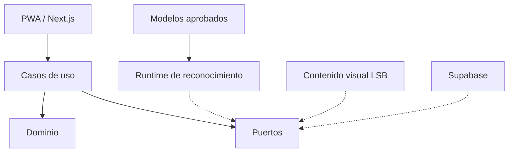

# La Voz de tus Manos

**Aplicación con Visión Artificial para la Interpretación de Lengua de Señas Boliviana en la Atención al Público**

> Proyecto universitario de ingeniería de software, accesibilidad e inteligencia artificial para facilitar la comunicación bidireccional durante trámites presenciales.

**Estado:** MVP en integración: ya permite iniciar sesión con Supabase Auth y guardar atenciones, conversaciones y observaciones en PostgreSQL con RLS por cuenta. La cámara detecta landmarks localmente con MediaPipe, pero la interpretación sigue simulada; todavía no hay clasificador LSB ni servicios institucionales. El avatar es ilustrativo y no traduce señas.

**Nombre anterior:** SignaLink.

**Lengua objetivo del proyecto académico:** Lengua de Señas Boliviana (LSB).

**Arquitectura prevista:** PWA modular, reconocimiento mediante modelos intercambiables e inferencia local cuando sea viable.

La implementación actual está en [`apps/web`](apps/web/README.md). Incluye `/login`, `/atender` y `/historial`, cámara con landmarks locales opcionales, revisión manual de propuestas simuladas, respuestas y filtros sobre registros persistidos. Las cuentas se crean desde Supabase Auth; cada cuenta solo puede acceder a sus propios registros.

---

## 1. Descripción

**La Voz de tus Manos** es una aplicación web progresiva (PWA) orientada a apoyar la comunicación entre personas sordas usuarias de Lengua de Señas Boliviana y personal de atención al público que no conoce dicha lengua.

Su escenario principal es la atención presencial durante trámites, registros y solicitudes de información.

La aplicación propone dos direcciones de comunicación:

**LSB → Español**

1. La persona utiliza la cámara del dispositivo.
2. Un modelo compatible procesa las señas.
3. El sistema presenta una interpretación sugerida en español.
4. La persona revisa, confirma o corrige el resultado.
5. El funcionario puede leer el mensaje confirmado.

**Español → LSB**

1. El funcionario escribe o dicta una respuesta.
2. Revisa y confirma el contenido.
3. El sistema busca una correspondencia disponible y validada en LSB.
4. Presenta el recurso visual correspondiente.
5. Si no existe una representación válida, informa la limitación y ofrece alternativas.

El proyecto no pretende sustituir a intérpretes profesionales ni garantizar la interpretación de cualquier conversación en LSB.

---

## 2. Objetivo principal

Desarrollar y evaluar un prototipo PWA que facilite interacciones comunicativas bidireccionales durante situaciones delimitadas de atención al público en Bolivia, mediante reconocimiento de expresiones en LSB y recursos visuales validados para presentar respuestas.

Este objetivo constituye una formulación preliminar, pendiente de consolidación académica mediante la investigación y validación de necesidades.

---

## 3. Alcance del MVP

### Funcionalidades prioritarias

- Sesiones de atención sin registro obligatorio.
- Captura de señas mediante cámara.
- Carga y ejecución de modelos compatibles de reconocimiento.
- Selección de lengua y modelo aprobado.
- Presentación de interpretaciones sugeridas.
- Confirmación, corrección y descarte de mensajes.
- Escritura y edición de respuestas.
- Dictado de voz cuando exista soporte compatible.
- Selección de respuestas conocidas con equivalencia LSB validada.
- Reproducción de videos LSB.
- Visor experimental para probar modelos 3D y sus clips de animación.
- Estados de error y alternativas accesibles.
- Finalización de sesiones y descarte de datos temporales.
- Interfaz mobile-first.

### Funcionalidades postergadas

- Entrenamiento automático dentro de la PWA.
- Adaptación automática de modelos a partir de conversaciones.
- Reconocimiento universal de señas.
- Traducción libre de conversaciones continuas.
- Generación automática de señas LSB mediante avatares; el visor 3D actual no valida ni traduce señas.
- Integraciones institucionales.
- Administración avanzada de trámites.
- Traducción ilimitada entre múltiples lenguas de señas.

El entrenamiento de modelos LSB propios se desarrollará como línea de investigación separada y no bloqueará la construcción del MVP.

---

## 4. Principios arquitectónicos

El proyecto utilizará:

1. **Screaming Architecture:** estructura organizada por capacidades del producto.
2. **Feature-First:** funcionalidades agrupadas en módulos independientes.
3. **Clean Architecture:** separación entre reglas de negocio, casos de uso, interfaces y adaptadores.
4. **Ports & Adapters:** integración intercambiable de servicios y modelos.
5. **Modular Monolith:** despliegue sencillo sin microservicios prematuros.
6. **Dependency Inversion:** los casos de uso dependen de abstracciones, no de frameworks.
7. **Contract Testing:** todos los adaptadores deben cumplir contratos verificables.

No se crearán abstracciones innecesarias cuando una función o componente simple sea suficiente.

---

## 5. Stack tecnológico propuesto

| Área | Tecnología |
|---|---|
| Frontend | Next.js, React, TypeScript |
| PWA | Manifest, Service Worker |
| Componentes | Tailwind CSS, shadcn/ui, Radix |
| Estado | Zustand |
| Validaciones | Zod |
| Datos remotos | Supabase JS con Row Level Security |
| Persistencia local | Zustand para estado de interfaz |
| Backend gestionado | Supabase |
| Base de datos | PostgreSQL |
| Autenticación de personal | Supabase Auth |
| Multimedia | Supabase Storage |
| Captura y landmarks | MediaPipe Tasks Vision |
| Inferencia | ONNX Runtime Web |
| Entrenamiento externo | Python, PyTorch |
| Pruebas unitarias | Vitest |
| Pruebas UI | Testing Library |
| Pruebas E2E | Playwright |
| Despliegue web | Vercel |
| Workspace | pnpm |

La selección definitiva depende de las pruebas de compatibilidad, rendimiento y necesidades reales del proyecto.

---

## 6. Arquitectura general



La interfaz no debe depender directamente de los formatos de tensor ni de la arquitectura específica del modelo.

El dominio de atención debe continuar funcionando con modelos simulados cuando no exista un modelo real disponible.

---

## 7. Modelos de reconocimiento intercambiables

La aplicación separa tres conceptos:

- **Lengua:** LSB, LSA, ASL u otra.
- **Modelo:** implementación entrenada para reconocer una clase de expresiones.
- **Motor:** tecnología encargada de ejecutar la inferencia.

Los modelos compatibles se describirán mediante manifiestos versionados.

Cada manifiesto debe declarar, como mínimo:

- Identificador y versión.
- Lengua de señas.
- Tipo de reconocimiento.
- Formato del modelo.
- Motor de inferencia.
- Contrato de entrada.
- Preprocesador.
- Decodificador.
- Etiquetas reconocibles.
- Licencia y restricciones.
- Integridad de los archivos.
- Estado de homologación.
- Limitaciones conocidas.

El registro solo permitirá ejecutar adaptadores aprobados y compatibles.

### Modelos considerados

| Modelo | Lengua | Estado |
|---|---|---|
| Freddy Villca Transformer ONNX | LSB | Candidato prioritario de integración |
| ASL Landmark MLP | ASL | Candidato experimental |
| ASL YOLO ONNX | ASL | Candidato para evaluar otra arquitectura |
| Modelo propio LSB | LSB | Entrenamiento futuro |
| Modelo LSA | LSA | Pendiente de selección y verificación |

La disponibilidad de un modelo externo no implica compatibilidad demostrada ni autorización automática para uso comercial.

### Modelo boliviano de referencia

Repositorio:

https://github.com/freddxvill/Proyecto_Traductor_de_la_LSB

Su implementación documenta 58 clases, ventanas de 30 fotogramas y 138 características por fotograma.

La integración deberá reproducir el preprocesamiento utilizado originalmente y verificar predicciones equivalentes entre Python y navegador.

La implementación web ya extrae landmarks con MediaPipe Holistic y prepara características de 138 dimensiones, pero el ONNX del repositorio todavía no está conectado ni validado.

---

## 8. Estructura prevista del repositorio

```text
apps/
  web/
    src/
      app/
      features/
        attention/
        sign-recognition/
        communication/
        sign-presentation/
        model-catalog/
        accessibility/
        content-management/
      composition/
      components/
      lib/
    tests/

packages/
  sign-model-contracts/
  recognition-runtime/
  shared-types/
  testing/

model-lab/
  datasets/
  src/
    collection/
    preprocessing/
    training/
    evaluation/
    export/
  notebooks/
  configs/
  tests/

models/
  registry/
  fixtures/

.agents/
  skills/
    lsb-corpus-entrenamiento/
    lsb-linguistic-validation/
    sign-model-adapter/
    sign-dataset-quality/
    sign-model-benchmark/
    accessible-service-ux/
    sign-response-content/
    architecture-guard/
    academic-traceability/
    lsb-traduccion-lengua-senas/

supabase/
  migrations/

docs/
  academic/
  architecture/
    adr/
    contracts/
  product/
    epics/
    stories/
    requirements/
  research/
  qa/

scripts/
.github/
```

Esta estructura representa la organización objetivo. No todas las carpetas están implementadas actualmente.

---

## 9. Estructura de cada feature

Las features de mayor complejidad podrán utilizar:

```text
feature/
  domain/
  application/
    ports/
    use-cases/
  infrastructure/
  presentation/
    components/
    hooks/
    stores/
  tests/
  index.ts
```

### Reglas de dependencias

- `domain` no depende de frameworks.
- `application` depende de dominio y contratos.
- `infrastructure` implementa los puertos requeridos.
- `presentation` utiliza casos de uso y estado de aplicación.
- Los imports entre features deben pasar por interfaces públicas.
- Los componentes React no ejecutan directamente consultas SQL ni inferencia.
- No se deben introducir dependencias circulares.
- Las abstracciones se aplicarán proporcionalmente a la complejidad funcional.

---

## 10. Áreas de trabajo

| Área | Responsabilidad |
|---|---|
| Arquitectura | Contratos, dependencias, CI y decisiones |
| Frontend/UX | Pantallas, navegación y atención compartida |
| Integración IA | MediaPipe, ONNX, adaptadores y runtime |
| Lingüística/Corpus | Vocabulario, glosas y validación LSB |
| Backend/Contenido | Supabase, videos y administración |
| QA/Investigación | Accesibilidad, pruebas y evaluación |

Cada módulo debe tener un responsable y criterios de aceptación verificables.

Los colaboradores deben coordinar los cambios de contratos antes de implementar dependencias entre módulos.

---

## 11. Plan CPM/PERT preliminar

Se utilizará planificación mediante ruta crítica (CPM) y estimación de tres puntos (PERT).

```text
A  Fundación y contratos
B  UX con modelo simulado
C  Runtime ONNX
D  Integración del modelo LSB
E  Comunicación mediante texto y voz
F  Contenido visual LSB
G  Integración bidireccional
H  Administración y Storage
I  Segundo modelo de referencia
J  QA integral
K  Evaluación piloto
L  Correcciones y cierre
```

Ruta crítica inicial:

`A → C → D → G → J → K → L`

Duración estimada de planificación: aproximadamente 38 días laborables bajo ejecución paralela.

Esta cifra es preliminar. La programación deberá ajustarse a la capacidad real del equipo y los bloqueos técnicos o lingüísticos identificados.

### Hitos

- **M0:** estructura, contratos y CI.
- **M1:** atención funcional con mock.
- **M2:** inferencia ONNX real.
- **M3:** segundo modelo intercambiable.
- **M4:** comunicación bidireccional.
- **M5:** administración básica.
- **M6:** QA y evaluación.

El modelo LSB propio no es una dependencia obligatoria para completar M0–M5.

---

## 12. Backlog inicial

### Épicas

| ID | Épica |
|---|---|
| EP-01 | Sesiones de atención |
| EP-02 | Reconocimiento de señas |
| EP-03 | Catálogo de lenguas y modelos |
| EP-04 | Comunicación en español |
| EP-05 | Representación visual LSB |
| EP-06 | Accesibilidad y privacidad |
| EP-07 | Administración de contenido |
| EP-08 | Investigación y evaluación |
| EP-09 | Entrenamiento y mejora continua |

### Convenciones de identificación

- `EP-XX`: épicas.
- `HU-XX`: historias de usuario.
- `RF-XX`: requisitos funcionales.
- `RNF-XX`: requisitos no funcionales.
- `N-XX`: necesidades identificadas.
- `OE-XX`: objetivos específicos.
- `ADR-XXX`: decisiones de arquitectura.
- `M0...M6`: hitos de desarrollo.

Los identificadores se conservarán estables después de aprobar cada elemento.

---

## 13. Skills del proyecto

Las skills son guías especializadas para colaboradores y agentes de desarrollo.

Se almacenan en `.agents/skills/<nombre>/SKILL.md`, una ruta que OpenCode descubre
automáticamente al iniciar una sesión desde el repositorio.

Cada skill debe establecer:

1. Objetivo y condiciones de activación.
2. Fuentes y fundamentos.
3. Entradas requeridas.
4. Procedimiento.
5. Restricciones.
6. Resultados esperados.
7. Criterios de verificación.
8. Ejemplos y scripts asociados.

### Skill de corpus LSB

La aportación de `Apaza` se integró de forma selectiva en
`.agents/skills/lsb-corpus-entrenamiento/`: incluye notas provisionales, ocho ejemplos
ilustrativos y tres scripts experimentales. La guía de la skill documenta el
alcance y las restricciones; [`references/README.md`](.agents/skills/lsb-corpus-entrenamiento/references/README.md)
registra las fuentes, la auditoría y el estado de derechos.

El archivo `vocabulario_lsb.json` no se incorporó: las fichas oficiales
consultadas no establecen una licencia de redistribución y la extracción
presenta IDs duplicados, glosas vacías y referencias de página incompletas.
Los documentos académicos son referencias de investigación, no datasets
completos ni sustitutos de grabaciones reales. La información lingüística y los
ejemplos requieren revisión por una persona competente en LSB antes de usarse
como reglas del producto o etiquetas aprobadas.

---

## 14. Investigación y entrenamiento LSB

El entrenamiento se mantendrá desacoplado del runtime de la PWA.

### Flujo previsto

```text
Bibliografía LSB
      ↓
Selección de vocabulario
      ↓
Validación lingüística
      ↓
Grabaciones autorizadas
      ↓
Etiquetado y control de calidad
      ↓
Extracción de landmarks
      ↓
Partición por participantes
      ↓
Entrenamiento de modelos
      ↓
Evaluación independiente
      ↓
Exportación ONNX
      ↓
Pruebas de contrato
      ↓
Publicación de modelo aprobado
```

Se comenzará con modelos temporales ligeros sobre características de manos y cuerpo. La inclusión de características faciales dependerá de los requisitos lingüísticos y la evaluación.

Se compararán arquitecturas como GRU, TCN y Transformer cuando el conjunto de datos lo permita.

No se afirmará precisión, generalización o capacidad de traducción sin resultados de evaluación.

---

## 15. Accesibilidad y privacidad

La aplicación tendrá como objetivo WCAG 2.2 AA.

Principios:

- Interfaz mobile-first.
- Comunicación visual clara.
- Navegación por teclado.
- Contraste adecuado.
- Controles multimedia accesibles.
- Mensajes legibles y confirmables.
- Alternativas ante errores de reconocimiento.
- Compatibilidad con dispositivos compartidos.
- Consentimiento explícito cuando se recolecten datos para investigación.
- Sin almacenamiento de video o audio de atención por defecto.
- Separación entre contenido temporal y contenido persistente.

La evaluación requerirá pruebas con usuarios representativos, no solamente verificadores automatizados.

---

## 16. Gestión de ramas y contribuciones

### Rama principal

`main` contendrá código revisado y versiones integradas.

### Ramas de trabajo

Nombres sugeridos:

```text
feat/attention-session
feat/onnx-runtime
feat/model-registry
feat/lsb-video-responses
feat/supabase-content
research/lsb-corpus
test/accessibility-e2e
docs/architecture
```

La rama histórica `Apaza` se revisó y se integró selectivamente como material
provisional; el vocabulario extraído permanece excluido hasta resolver permisos
y corregir los hallazgos registrados en la skill de corpus LSB.

### Flujo de contribución

1. Crear o asignar un GitHub Issue.
2. Identificar épica, HU o tarea técnica relacionada.
3. Definir criterios de aceptación.
4. Trabajar en una rama específica.
5. Incorporar pruebas y documentación correspondiente.
6. Abrir Pull Request hacia `main`.
7. Ejecutar CI y revisión.
8. Integrar después de cumplir los controles de calidad.

Evitar ramas de larga duración y modificaciones simultáneas de contratos sin coordinación.

### Reglas de Pull Request

Cada PR debe indicar:

- Problema o necesidad resuelta.
- Issue y requisitos relacionados.
- Archivos o módulos modificados.
- Contratos afectados.
- Pruebas ejecutadas.
- Capturas cuando exista cambio visual.
- Riesgos y limitaciones.
- Evidencia de funcionamiento.

Las funcionalidades de IA deben identificar el modelo utilizado y sus limitaciones.

---

## 17. Definition of Done

Una tarea se considera completada cuando:

- Cumple sus criterios de aceptación.
- Respeta los límites arquitectónicos.
- Compila correctamente.
- Pasa las pruebas pertinentes.
- No introduce dependencias circulares.
- Incluye estados de error.
- Documenta cambios de contratos.
- No introduce almacenamiento indebido de información sensible.
- Dispone de revisión técnica.
- Tiene evidencia suficiente para verificarla.

Para nuevas integraciones de modelos, se exigen además pruebas de compatibilidad, integridad y consistencia de las predicciones.

---

## 18. Estado real del proyecto

| Área | Estado |
|---|---|
| Problema y enfoque | Definición preliminar |
| Índice académico | Propuesta aprobada para desarrollo |
| Arquitectura | Diseño propuesto |
| Corpus documental | Referencias iniciales disponibles |
| Skills LSB | Trabajo disponible en ramas |
| Modelo LSB propio | No entrenado |
| Modelo externo LSB | Candidato identificado |
| PWA funcional | Prototipo web funcional; modo offline pendiente |
| Comunicación bidireccional | Definición funcional |
| Evaluación con usuarios | Pendiente |
| Despliegue productivo | Pendiente |

No declarar funcionalidades completadas sin pruebas ni evidencia.

---

## 19. Referencias iniciales

- Ministerio de Educación de Bolivia. (2010). *Curso de enseñanza de la Lengua de Señas Boliviana. Módulo 1*.
- Villca Villegas, F. (2023). *Traductor del deletreo manual de la Lengua de Señas Boliviana a texto utilizando algoritmos de aprendizaje automático*. GitHub. https://github.com/freddxvill/Proyecto_Traductor_de_la_LSB
- W3C. *Web Content Accessibility Guidelines (WCAG) 2.2*. https://www.w3.org/TR/WCAG22/
- Google AI. *MediaPipe*. https://ai.google.dev/edge/mediapipe/solutions/guide
- ONNX Runtime. *ONNX Runtime Web*. https://onnxruntime.ai/docs/tutorials/web/
- PyTorch. *Documentation*. https://docs.pytorch.org/
- Hugging Face. *Model Hub*. https://huggingface.co/models

Las referencias académicas definitivas y sus metadatos bibliográficos serán verificados durante la elaboración del informe.

---

## 20. Licencia y derechos

La licencia del código propio del proyecto todavía debe definirse.

Los modelos externos, datos, imágenes y materiales lingüísticos mantienen sus licencias y condiciones particulares.

No se presume que el carácter público de un recurso permita su reproducción, redistribución o uso comercial.

Antes de publicar datasets o modelos entrenados con material de terceros, se revisarán sus derechos y restricciones.

---

**La Voz de tus Manos — Tecnología para facilitar la comunicación, diseñada con respeto por la lengua y la comunidad que la utiliza.**
